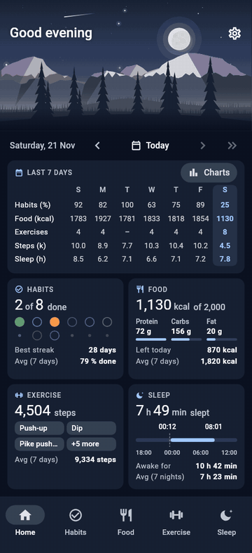

<div align="center">


# Ippo

**Keep track of your habits, food, exercise and sleep<br>
in one calm, private app.**

Free and open source, for Android and Linux.
No account, no ads, and it never goes online.

<table>
  <tr>
    <td align="center" width="33%">
      <br>
      <b>A quick tour</b>
    </td>
    <td align="center" width="33%">
      <br>
      <b>Logging a day</b>
    </td>
    <td align="center" width="33%">
      <br>
      <b>Charts and details</b>
    </td>
  </tr>
</table>

<sub>Recorded from the app itself, with its built-in example data.</sub>

</div>

**Ippo** is a simple, private app for the everyday things that shape
your health: your habits, what you eat, your workouts and your sleep.
Logging takes a moment. Over weeks and months, Ippo shows you the bigger
picture.

Ippo (一歩) means "one step" in Japanese, from the saying "a journey of
a thousand miles begins with a single step." Small steps, taken every
day, add up.

> **Still early.** Ippo works, but it isn't in any app store yet, and it
> will keep changing as it grows.

## What it does

**Home** shows your day in one place. A small table lays out the past
week, and below it each part of the app has its own tile. Tap any day
to see how it went.

**Habits.** Tick off your habits each day in a grid of the last few
weeks. Not every habit has to be daily: set one to a few times a week,
or every few days, and the days in between won't count against you.
Give each habit its own colour, and a note if its name is short. Home
shows your best streak.

**Food.** Save the foods you eat often, with the numbers from their
labels. Logging a meal is then just a matter of picking the food and
the amount, in grams or in pieces like "2 slices". Eating out? A quick
entry only needs a name and the calories.

Adding a new food is quicker if you paste in its nutrition label. Take
a photo, let an AI assistant read it, and paste the answer
([here's how](docs/food-labels.md)). The Food tab then shows the day's
calories, protein, carbs and fat against your limit, along with any
vitamins and minerals your labels list. You can set your own daily
goals, and log your weight there too.

**Exercise.** Add the exercises you do, counted in reps or in seconds.
Each set takes one tap, and your last session sits right next to today,
so you can see whether you're getting stronger. Your daily steps go
here as well.

**Sleep.** Note when you woke up and when you went to bed. "Going to bed
now" fills in the time for you. Naps go here too, and last night shows
up as a bar across the clock.

**Charts** show how things change over time: your weight, calories,
protein, steps, best set for each exercise, sleep, and habits. Each
chart plots your daily numbers with a running average, and tells you how
much they vary and which way they're heading. Look at the last week,
month or year, or pick any dates you like. At the top, a short summary
compares your last week with the four weeks before it.

**Make it look the way you like.** Pick light or dark, with true black
for OLED screens. Use your phone's accent colour or choose your own,
and switch between metric and imperial, or 24- and 12-hour time.

Want to look around first? Tap **Show example data** on the welcome
screen or in Settings, and Ippo fills up with four weeks of made-up
days. None of it is saved, and your own data comes back as soon as
you're done.

Ippo is completely free. There's nothing to buy and nothing locked away.

## Your data stays yours

- **It never goes online.** The Android app doesn't even ask for
  internet access, so your phone won't let it connect. There are no
  accounts, no ads and no tracking.
- **It's kept in plain files.** Your data lives in a folder you choose,
  as text files you can open, copy and keep for as long as you like.
  Ippo backs them up once a month, and whenever you tap **Back up now**.
- **It works across devices.** Point your phone and computer at the same
  folder and keep it in sync with something like
  [Syncthing](https://syncthing.net). Each device writes to its own
  file, so syncing never causes conflicts, and Settings tells you when
  each device was last seen.
- **It's ready for analysis.** If you like digging into numbers, a small
  Python package turns your folder into tidy tables. It can also export
  them as CSV or Parquet, with every column explained, for a
  spreadsheet, pandas or R. See [`python/README.md`](python/README.md).

## Getting Ippo

Ippo isn't in any app store yet, so for now you install it yourself.
It only takes a minute.

### On Android

1. On your phone, open this project's
   [Releases page](../../releases/latest) and download the newest file
   ending in `.apk`.
2. Open the downloaded file. Android will ask whether your browser (or
   file manager) may install apps. Allow it for this one time, then go
   back.
3. Tap **Install**, then **Open**.

The first time Ippo opens, it asks where to keep your data: pick or
create a folder, such as `Documents/Ippo`. Or tap **Show example data**
to look around first.

To update, download the newer `.apk` and install it the same way. Your
data stays where it is.

> **Please read before installing.** An `.apk` from outside an app
> store skips the store's checks, so only download Ippo from this
> project's Releases page, never from a copy somewhere else. Ippo is
> early software and comes with no warranty of any kind (see the
> [license](LICENSE)). It could have bugs that lose or mix up data, so
> keep a backup of your data folder. You install and use it at your own
> risk.

### On Linux

There's no ready-made download for Linux yet. You can build Ippo
yourself: [`docs/development-setup.md`](docs/development-setup.md)
walks you through it step by step.

It's also on its way to [F-Droid](https://f-droid.org), which will make
installing and updating as easy as any other app.

## For developers

Ippo is built with Flutter. The code is written to be easy to read,
easy to change and easy to trust, and contributions are welcome,
especially from people just starting out.

- [`CONTRIBUTING.md`](CONTRIBUTING.md) explains how the code is written
  and what to check before opening a pull request.
- [`docs/data-principles.md`](docs/data-principles.md) and
  [`docs/data-format.md`](docs/data-format.md) describe how the data is
  recorded and stored.
- [`docs/design.md`](docs/design.md) covers how each screen looks and
  behaves.
- [`docs/permissions.md`](docs/permissions.md) and
  [`docs/dependencies.md`](docs/dependencies.md) list every permission
  and package the app uses, and why.

Each part of the app (habits, food, exercise, sleep) is its own module,
so new ones can be added to the code without touching the rest.

```bash
flutter run -d linux      # run on the Linux desktop
flutter run               # run on a connected Android phone
flutter test              # run the tests
```

## License

Ippo is free software under the GNU General Public License, version 3
or later. See [`LICENSE`](LICENSE).
