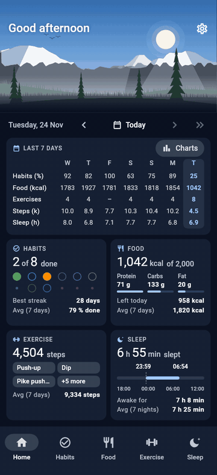

<div align="center">


# Ippo

**Habits, food, exercise and sleep, in one calm app,<br>
on plain files you own, ready to analyse.**

Free and open source, for Android and the Linux desktop.
No account, no network, no ads.

<table>
  <tr>
    <td align="center" width="33%">
      <br>
      <b>A quick tour</b>
    </td>
    <td align="center" width="33%">
      <br>
      <b>Logging a day</b>
    </td>
    <td align="center" width="33%">
      <br>
      <b>Charts and details</b>
    </td>
  </tr>
</table>

<sub>Recorded from the app itself, with its built-in example data.</sub>

</div>

**Ippo** is a simple, private app for the everyday things that shape
your health: your habits, what you eat, your workouts and your sleep.
Logging takes a moment. Over weeks and months, Ippo shows you the bigger
picture.

Ippo (一歩) means "one step" in Japanese, from the saying "a journey of
a thousand miles begins with a single step." Small steps, taken every
day, add up.

> **Status:** early development. Ippo works, but it is not on an app
> store yet, and things will still change.

## What you can do

**Home** sums up your day at a glance: the last seven days side by
side, and a tile for each part of the app. Tap a day to look back at
it.

**Habits.** Tick off each habit every day (✓ done, ✗ not done) in a grid
of the last few weeks. A habit can be daily, a few times a week, or
every few days, so a rest day never counts as missed. Give each one a
colour and a short description, and see your best streak.

**Food.** Keep a list of your foods with their label values, then log
what you eat by picking a food and an amount (in grams, or in pieces
such as "2 slices"). For a restaurant meal, a quick entry takes just a
name and the calories. Fill a food in from its nutrition label by
pasting the label's text, or a photo read by an AI assistant
([how](docs/food-labels.md)). See the day's energy, protein, carbs and
fat against your daily limit, every vitamin and mineral the labels give,
and set your own daily goals. Log your weight on the same screen.

**Exercise.** Add your exercises, counted in reps or in seconds, and log
each set with one tap, next to what you did last time. Steps for the
day go here too.

**Sleep.** When you woke up and went to bed each day ("Going to bed now"
fills in the time), and naps. Last night is shown as a bar on the
clock.

**Charts.** Every measure over time: weight, energy, protein, steps,
your best set of each exercise, hours slept and sleep times, habits
done. Each chart shows the daily values, a running average, how much
they vary, and the change per week, for a week, a month, three months,
a year, all time, or any dates you pick. A summary at the top compares
your last week with the four weeks before.

**Make it yours.** Light or dark, true black for OLED screens, your
phone's accent colour or one you pick, metric or imperial units, a 24 or
12-hour clock.

**See it with example data** first, if you like: on the welcome screen
or in Settings, **Show example data** fills Ippo with four weeks of
made-up days. It is kept only in memory and thrown away when you go
back to your own data. Ippo is free: everything it does is available
to everyone.

## Your data stays yours

- **Nothing goes online.** The Android app does not even ask for
  internet access, so the phone itself stops it from connecting. There
  are no accounts, no ads, and no tracking.
- **Your data is plain files in a folder you choose.** You can open them
  in a text editor, copy them anywhere, and keep them for as long as you
  like. Ippo also backs up its own file once a month, and whenever you
  tap **Back up now**.
- **Use it on more than one device.** Point each device at the same
  folder and keep the folder in sync with a tool such as
  [Syncthing](https://syncthing.net). Each device writes only its own
  file, so syncing never causes conflicts, and Settings shows when each
  device was last heard from.
- **Analyse it yourself.** Your history is made to be studied: a small
  Python package turns the folder into tables, or exports them as CSV
  (and Parquet) with a description of every column, ready for a
  spreadsheet, pandas, R, or a statistics course. See
  [`python/README.md`](python/README.md).

## Getting Ippo

Ippo runs on **Android** and on the **Linux desktop**. There are no
ready-made downloads yet; it is planned for
[F-Droid](https://f-droid.org). Until then, it can be built from the
source code: [`docs/development-setup.md`](docs/development-setup.md)
explains how, step by step.

## For developers and contributors

Ippo is written in Flutter and meant to be easy to read, change and
trust. Contributions are welcome, especially from beginners.

- [`CONTRIBUTING.md`](CONTRIBUTING.md): how the code is written, and
  what to check before a pull request.
- [`docs/data-principles.md`](docs/data-principles.md) and
  [`docs/data-format.md`](docs/data-format.md): how the data is
  recorded and stored, in full.
- [`docs/design.md`](docs/design.md): how every screen looks and
  behaves.
- [`docs/permissions.md`](docs/permissions.md) and
  [`docs/dependencies.md`](docs/dependencies.md): every permission and
  package the app uses, and why.

The app is built from modules (habits, food, exercise, sleep), and a new
module can be added to the code without changing the others.

```bash
flutter run -d linux      # run on the Linux desktop
flutter run               # run on a connected Android phone
flutter test              # run the tests
```

## License

Ippo is free software, released under the GNU General Public License,
version 3 or later. See [`LICENSE`](LICENSE).
